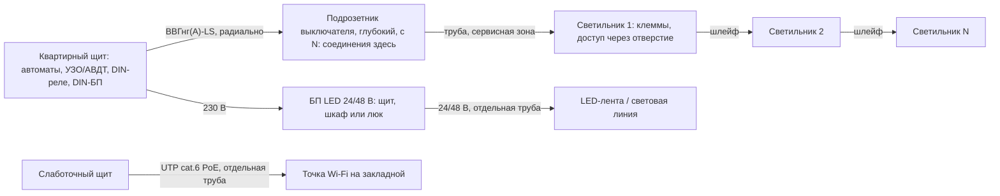

# Спецификация (черновик требований): электрика и освещение в потолочном пространстве — звукоизоляционный потолок + натяжной потолок

> Версия: 0.1 · Дата: 2026-11-04 · Автор: electrical-engineer · Статус: **ПРЕДЛОЖЕНО**. Решения в реестре нет, это предварительная проработка на этапе 1, работы не начинаются.
> Класс: К2 — трассы, свет, потолочное оборудование; К1 — группы и защитная автоматика (их оформляем отдельно на этапе 3, после данных о щите и мощности).
> Смежные документы (оба — ПРЕДЛОЖЕНО): `project/specifications/2026-11-04-ceiling-soundproofing-concept.md` (construction-engineer) и `project/specifications/2026-11-04-ceiling-ventilation-requirements.md` (hvac-engineer). Здесь собраны требования электрики к этим системам; несогласованные стыки — в разд. 15.

## 0. Суть требований (коротко)
1. **Вся электрика и слаботочка — в сервисной зоне ниже звукоизоляционной мембраны.** Над мембраной, в полости с минватой, нет ни кабелей, ни соединений. Проходок через мембрану — ноль. Если проходка неизбежна, её согласует construction-engineer и она герметизируется `[ПРАКТИКА]`.
2. **За натяжным полотном нет ни одного соединения без доступа.** Соединять можно в щите, в подрозетниках выключателей, в стенных коробках ниже полотна, в клеммах светильника (доступ через его отверстие) или под ревизионным люком (разд. 3.5) `[НОРМА — ПРОВЕРИТЬ пункты, разд. 3.1]`.
3. **Кабель — медный ВВГнг(А)-LS, проложенный в трубах.** По умолчанию — стальная труба или металлорукав. Неметаллическая труба с пожарным сертификатом допустима, только если у выбранного полотна подтверждена группа горючести Г1 и это допускает действующая редакция СП 256.1325800 п. 15.15 (разд. 3.3) `[НОРМА — ПРОВЕРИТЬ]`.
4. **Блоки питания, драйверы, умные реле, вентиляторы и установки размещаются только там, где их можно заменить без демонтажа полотна** и где они охлаждаются. В минвате — никогда `[ПРАКТИКА]`.
5. **Глубину сервисной зоны H_сз задаёт самый «высокий» элемент в помещении.** Ориентир — 35–110 мм (разд. 10). Окончательное значение — после выбора светильников и профилей и решения hvac по воздуховодам.

## 1. Исходные данные и ограничения
| Параметр | Значение | Маркировка |
|---|---|---|
| Объект | СПб, новостройка 2026; наружные стены — кирпич, внутренние несущие — панели; 1-й этаж из 4; 62,20 м²; газа нет | `[ФАКТ]` apartment.md |
| Пожелания | шумоизоляция потолка; электрика и вентиляция по потолку; чистовой потолок — натяжной | `[ФАКТ]` apartment.md, журнал 2026-11-04 |
| Высота потолков | нет данных | `[ПРОВЕРИТЬ]` замер |
| Тип перекрытия | нет данных | `[ПРОВЕРИТЬ]` |
| Отделка от застройщика (стяжка, штукатурка) | нет данных | `[ПРОВЕРИТЬ]` |
| Щит, разрешённая мощность, система заземления, наличие PE | нет данных | `[ПРОВЕРИТЬ]` |
| Разводка застройщика, выводы на потолке, пожарные извещатели | нет данных | `[ПРОВЕРИТЬ]` |
| Концепция освещения | нет | этапы 2–3 |
| Полотно (ПВХ или ткань), группа горючести | не выбрано | `[ПРОВЕРИТЬ]` по сертификату |
| Звукоизоляция потолка | вероятно: каркас на виброподвесах + минвата + 2 слоя листов («мембрана»), под ней сервисная зона и полотно | `[ПРЕДПОЛОЖЕНИЕ]` концепция construction-engineer в работе |
| Воздуховоды | над мембраной или в сервисной зоне — решает hvac-engineer | `[ПРЕДПОЛОЖЕНИЕ]` |

## 2. Схема
### 2.1 Разрез потолка (принцип, без размеров)
```
══════════ плита перекрытия (тип — ПРОВЕРИТЬ) ══════════
  ЗОНА А — звукоизоляция: виброподвесы, каркас, минвата
           ЭЛЕКТРИКИ НЕТ: ни кабелей, ни коробок, ни соединений
━━━━━━━━ МЕМБРАНА: 2 слоя листов, швы и примыкания загерметизированы ━━━━━━━━
  ЗОНА Б — сервисная зона, глубина H_сз:
           трубы/металлорукав с кабелями (крепятся к мембране/каркасу),
           закладные, корпуса светильников, выносные драйверы у отверстий,
           (воздуховоды — если hvac разместит их здесь)
────── натяжное полотно + термокольца (свет, решётки, извещатели, Wi-Fi) ──────
```

### 2.2 Топология подключения (без недоступных соединений)


## 3. Прокладка кабеля над натяжным потолком
### 3.1 Нормативная рамка
| Документ | Суть | Маркировка |
|---|---|---|
| ПУЭ 7-е изд., гл. 2.1 (по памяти — п. 2.1.42) | Прокладка за непроходными подвесными потолками считается скрытой. За потолками из горючих материалов — в металлических трубах, обладающих локализационной способностью, или в закрытых коробах. За потолками из негорючих материалов — в трубах и коробах из негорючих или трудногорючих материалов. Сменяемость кабелей должна быть обеспечена | `[НОРМА — ПРОВЕРИТЬ]`: поиском найден только аналогичный текст в украинской редакции правил (dnaop.com); номер и текст российской редакции не подтверждены |
| СП 256.1325800.2016, п. 15.15 | Проводка в полостях над непроходными подвесными потолками считается скрытой; кабели — по ГОСТ 31565. За потолками из негорючих материалов или материалов группы Г1 допускаются неметаллические трубы и короба, отвечающие требованиям пожарной безопасности. Натяжные потолки отдельно не названы | `[НОРМА — ПРОВЕРИТЬ]`: известно из вторичного источника (результаты поиска по ответам экспертов NormaCS); первоисточник не открыт — normacs.info недоступен в этой сессии. Сверить с действующей редакцией с изменениями |
| ПУЭ гл. 2.1 | Места соединений и ответвлений доступны для осмотра и ремонта; соединения выполняются опрессовкой, сваркой, пайкой или сжимами | `[НОРМА — ПРОВЕРИТЬ номера пунктов]` |
| ГОСТ Р 50571.5.52-2011 (МЭК 60364-5-52), п. 526.3 | Соединения доступны для осмотра, испытаний и обслуживания. Исключения — например, соединения, залитые компаундом или выполненные опрессовкой | `[НОРМА — ПРОВЕРИТЬ редакцию]` |
| Полотно | Группа горючести — по сертификату и протоколу. По вторичным источникам, стандартный ПВХ обычно относится к Г2–Г3, с антипиренами достигает Г1; антипирен не делает материал негорючим. Для тканевых полотен — нет данных | `[ПРОВЕРИТЬ]` по документам выбранного полотна; источники в разд. 13 (не производители) |

**Рабочая трактовка до сверки норм** `[ПРЕДПОЛОЖЕНИЕ — консервативно]`: натяжной потолок считаем «непроходным подвесным потолком». Если у полотна нет подтверждённой группы Г1, считаем его горючим материалом.

### 3.2 Кабель
- Медь, ВВГнг(А)-LS `[НОРМА: ПУЭ п. 7.1.34 (медные жилы в зданиях) — ПРОВЕРИТЬ формулировку; ГОСТ 31565-2012; СП 256 п. 15.15 — ПРОВЕРИТЬ]`. FRLS — для систем, которые должны работать при пожаре; для квартирного освещения обычно не требуется `[ПРАКТИКА]`.
- Сечение: ориентир 1,5 мм² для освещения (автомат 10 А) и 2,5 мм² для розеток (16 А) `[ПРАКТИКА]`. Окончательно — расчётом на этапе 3: допустимый ток по способу прокладки, падение напряжения.
- Число жил: 3 (L, N, PE). Для групп, которые, возможно, будут диммироваться, — резерв (5-жильный кабель или отдельная линия управления) под выбранный протокол `[ПРАКТИКА; ПРОИЗВОДИТЕЛЬ драйверов]`. Вентилятору с таймером нужно 4 жилы (L, Lт, N, PE) `[ПРОИЗВОДИТЕЛЬ — по схеме модели]`.
- Цепи 24/48 В (БСНН) и UTP прокладываются отдельно от 230 В, в своих трубах `[НОРМА: ГОСТ Р 50571.3-2009 (МЭК 60364-4-41) — разделение цепей БСНН, ПРОВЕРИТЬ пункт; ПРАКТИКА для UTP]`.
- Последний участок к светильнику — гибкие выводы или клеммник светильника по его инструкции `[ПРОИЗВОДИТЕЛЬ]`. Жёсткий кабель многократно не перегибать. Запас длины — такой, чтобы светильник можно было опустить через отверстие `[ПРАКТИКА]`.

### 3.3 Защита кабеля — варианты
| Вариант | Когда допустим | Плюсы | Минусы | Маркировка |
|---|---|---|---|---|
| **А. Стальная труба или металлорукав**, концевые втулки, вводы через фитинги | при любом полотне | соответствует строгой трактовке ПУЭ для горючих потолков; защищает кабель при монтаже полотна | дороже, больше радиус изгиба. Считается ли металлорукав «трубой с локализационной способностью» и нужно ли присоединять его к PE — решает электрик | `[НОРМА — ПРОВЕРИТЬ]` `[ПРАКТИКА]` |
| **Б. Неметаллическая труба с пожарным сертификатом** (не распространяющая горение; предпочтительно безгалогенная) | только если у полотна подтверждена группа Г1 **и** действующая редакция СП 256 п. 15.15 это допускает | дешевле, проще | специалисты спорят, соответствуют ли ПВХ-трубы «нг» требованиям LS для жилых зданий | `[НОРМА — ПРОВЕРИТЬ]` |
| В. Кабель без трубы, «по плите» или «на полотне» | **ОТКЛОНЕНО** | — | нет сменяемости и механической защиты; противоречит разд. 3.1 | — |

Рекомендация `[ПРЕДЛОЖЕНО]`: по умолчанию — **А**. На **Б** переходим только при наличии сертификата Г1 на выбранное полотно и подтверждения электрика или проектировщика. Разницу в стоимости считает financial-controller.

### 3.4 Крепление и трассы
- Трубы крепятся к основанию сервисной зоны — нижней плоскости мембраны: в профили каркаса (разметку профилей даёт construction-engineer) или анкерами для листовых материалов в пределах их допускаемой нагрузки `[ПРОИЗВОДИТЕЛЬ]`. Не крепить к полотну, профилю натяжного потолка, воздуховодам и их подвесам `[ПРАКТИКА]`.
- Шаг клипс — по инструкции производителя трубы или клипс; провисов до полотна быть не должно `[ПРОИЗВОДИТЕЛЬ — ПРОВЕРИТЬ]`.
- Трассы идут только параллельно или перпендикулярно стенам `[ПРАКТИКА]`. **Горизонтальные трассы в стенах не делаем**: стенка в полосе крепления профиля натяжного потолка, теневого профиля и карнизов будет засверливаться. Все горизонтали — в сервисной зоне, в стенах — только вертикальные спуски `[ПРАКТИКА]`.
- Сменяемость: трубы прокладываются между точками доступа (закладная светильника, стенная коробка), с плавными поворотами и минимумом поворотов `[ПРАКТИКА]`.
- До монтажа полотна каждую трассу фотографируют с рулеткой от двух стен и составляют исполнительную схему с привязкой к чистовым стенам и отметке полотна `[ПРАКТИКА]`. Это точка контроля HP-2.
- При монтаже ПВХ-полотна помещение прогревают примерно до 50–60 °C. Цифра взята из материалов монтажников в выдаче поиска, точный источник не установлен `[ПРАКТИКА — ПРОВЕРИТЬ у монтажной организации]`. Поэтому электронику (извещатели, точки доступа, датчики, БП) на это время снимают или защищают. Ткань обычно монтируют без нагрева `[ПРАКТИКА — ПРОВЕРИТЬ у производителя системы]`.

### 3.5 Соединения: где нельзя и где можно
**Нельзя:** над мембраной — никогда; в сервисной зоне за полотном — если к месту нет доступа `[НОРМА — разд. 3.1, ПРОВЕРИТЬ]`. Снятие полотна доступом не считаем: для ПВХ это работа монтажника, а ткань при повторном монтаже может не восстановиться `[ПРАКТИКА — ПРОВЕРИТЬ у производителя]`.

**Можно, в порядке предпочтения:**
1. в щите — радиальные линии без промежуточных коробок;
2. в подрозетниках выключателей — глубоких, с нейтралью `[ПРАКТИКА]`;
3. в распаечных коробках в стенах ниже уровня полотна, если крышка не закрыта плиткой или другой неразборной отделкой `[ПРАКТИКА]`;
4. в клеммах у светильника, шлейфом «светильник → светильник», с доступом через монтажное отверстие при извлечении светильника `[ПРАКТИКА]`. Допускает ли светильник транзитный шлейф и на какой ток — по его паспорту `[ПРОИЗВОДИТЕЛЬ]`;
5. под ревизионным люком в полотне — для узлов, которые обслуживают (вентилятор, установка, БП, приводы). Данных по конкретной системе люков нет `[ПРОИЗВОДИТЕЛЬ — нет данных]`.

Клеммы подбираются под сечение, ток и тип жилы `[ПРОИЗВОДИТЕЛЬ]`. Скрутки без сжимов не допускаются `[НОРМА: ПУЭ гл. 2.1 — ПРОВЕРИТЬ пункт]`.

**Выводы застройщика на потолке** (если есть) `[ПРЕДПОЛОЖЕНИЕ — зависит от фактической разводки]`: наращивание провода над мембраной даст недоступное соединение, поэтому так делать нельзя. Варианты: (а) электрик отключает и изолирует эти линии со стороны щита и концы маркируются; (б) используется кабель целиком, без соединений, и через мембрану делается одна загерметизированная проходка — по согласованию с construction-engineer.

### 3.6 Светильники, нагрев, закладные
- Любая точка в полотне (светильник, решётка, извещатель, точка доступа, датчик, трек, динамик) ставится на закладную. Закладная крепится к основанию сервисной зоны и выставляется лазером в плоскость полотна; в полотне — термокольцо `[ПРАКТИКА]`. Монтаж через закладную и кольцо (для ПВХ — отдельная резинка) описан в руководстве к встраиваемому светильнику (PDF на transistor.ru) `[ПРОИЗВОДИТЕЛЬ — общий принцип; производитель в файле не установлен]`.
- Только LED. От светильников «тарелочного» типа с металлическим основанием отказаться — оно нагревается. Глянцевые ПВХ-полотна не рекомендуют в помещениях, где бывает выше 40 °C `[ПРАКТИКА — медиа из выдачи поиска (t-j.ru, focus.ua), не производитель]`.
- **Предельная мощность ламп и минимальные расстояния от светильника или драйвера до полотна — данных производителя полотна нет.** Нужно запросить паспорт выбранного полотна и светильника `[ПРОВЕРИТЬ]`.
- Светильники и драйверы утеплителем не накрывать: минвата лежит только над мембраной, в сервисной зоне её нет. Иначе — только светильники с соответствующей маркировкой `[ПРОИЗВОДИТЕЛЬ — ГОСТ IEC 60598-2-2, ПРОВЕРИТЬ]`. Драйверы выбирать под температуру закрытой сервисной зоны (ta/tc) и не собирать их в одном месте `[ПРОИЗВОДИТЕЛЬ]`.
- Тяжёлые светильники вешаются на усиленную закладную, закреплённую к профилям каркаса. Допустимую нагрузку на каркас и виброподвесы даёт construction-engineer `[ПРОИЗВОДИТЕЛЬ подвеса — ПРОВЕРИТЬ]`. Нагрузка на полотно не передаётся.
- Ванная и санузел: зоны 0/1/2 по ГОСТ Р 50571.7.701-2013 (МЭК 60364-7-701); высоту зоны 1 (2,25 м) сопоставить с отметкой полотна. Светильники — не ниже IPX4 `[НОРМА — ПРОВЕРИТЬ пункты; ПРАКТИКА: IPX4 и выше 2,25 м]`. Все цепи ванной — через УЗО/АВДТ не более 30 мА `[НОРМА — ПРОВЕРИТЬ пункт]`. Требования к ДСУП — уточнить `[ПРОВЕРИТЬ]`.

## 4. Сочетание со звукоизоляцией
Принцип: мембрана остаётся сплошной, вся электрика — ниже неё `[ПРАКТИКА]`.

| Элемент | Решение | Влияние на H_сз | Обслуживание | Маркировка |
|---|---|---|---|---|
| Пересечение кабельной трубы с воздуховодом | по возможности обходить: спуском по стене или трассой в обход. Если пересечение неизбежно — труба идёт под воздуховодом, и сервисная зона в этом месте растёт на d_тр (разд. 10.1) | +20 мм к зоне воздуховода | — | `[ПРАКТИКА]` |
| Встраиваемые споты | корпус в сервисной зоне, закладная крепится к мембране; в листы мембраны **не врезать**. Драйвер — выносной, рядом со светильником, извлекается через отверстие | H_сз ≥ h_св + ~20 мм | через отверстие светильника; размер драйвера сверить с отверстием | `[ПРАКТИКА; ПРОИЗВОДИТЕЛЬ]` |
| Накладные споты, люстры, подвесы | закладная-площадка, вес передаётся на каркас | минимальное | снятием светильника | `[ПРАКТИКА]` |
| Накладной трек на полотне | сплошная закладная (брус или профиль) по всей длине трека, крепится к каркасу | минимальное | — | `[ПРАКТИКА]` |
| Встраиваемый (магнитный) трек | специальный профиль с гарпунным пазом, глубина — по системе. БП (обычно 48 В) — в доступном месте | по системе — нет данных | БП — в щите, шкафу или под люком | `[ПРОИЗВОДИТЕЛЬ — нет данных, ПРОВЕРИТЬ]` |
| Теневой профиль / «парящий» потолок | профиль на стенах на отметке полотна; горизонтальных трасс в стене в зоне крепления нет. Лента меняется снизу без демонтажа полотна — выбирать такую систему | по профилю — нет данных | — | `[ПРОИЗВОДИТЕЛЬ — ПРОВЕРИТЬ]` |
| Световые линии, LED-ленты | алюминиевый профиль-радиатор; на длинных отрезках — питание с двух концов. БП с запасом мощности ≥ 20–30 %, в доступном проветриваемом месте | по профилю | — | `[ПРАКТИКА; ПРОИЗВОДИТЕЛЬ ленты]` |
| Драйверы, БП, умные реле | в щите (DIN), в шкафу или нише с решёткой, под люком. Не в минвате и не «наглухо» за полотном | — | замена без демонтажа полотна | `[ПРАКТИКА]` |
| Неизбежные проходки через мембрану (кабель застройщика, анкер тяжёлой люстры, воздуховод) | минимальное отверстие; герметизация — по решению construction-engineer | — | — | `[ПРАКТИКА]` |
| Подрозетники в межквартирных стенах и перегородках | по возможности избегать; не ставить «спина к спине»; герметизировать — по решению construction-engineer | — | — | `[ПРАКТИКА]` |

## 5. Вентиляция и другое оборудование на потолке
| Оборудование | Питание и управление | Требования | Маркировка |
|---|---|---|---|
| Вытяжные вентиляторы ванной и санузла | от группы освещения помещения или от отдельной группы; УЗО/АВДТ 30 мА; кабель на 3–4 жилы по схеме (таймер, датчик влажности) | IP — по зоне; работает от обычного выключателя без «умной» части; обратный клапан — hvac | `[ПРОИЗВОДИТЕЛЬ; НОРМА 50571.7.701 — ПРОВЕРИТЬ]` |
| Вентилятор в вентотверстии (на стене) | подвод — сверху из сервисной зоны (спуск по перегородке) или по соседней перегородке; соединение — в клеммнике вентилятора, доступ при снятой лицевой панели | **стенки вентблока не штробить** — это общее имущество, красная линия. Монтаж кабеля в стене — до штукатурки, а не «до мембраны» | `[ПРАКТИКА; ПРОИЗВОДИТЕЛЬ]` |
| Канальный вентилятор (если будет в потолке) | от той же группы или отдельной | только под ревизионным люком; виброизоляция — hvac/construction | `[ПРАКТИКА]` |
| Бризеры (если выберет hvac) | розетка или вывод рядом — по инструкции. Модели с подогревом могут потреблять порядка киловатта (по hvac) — учесть в балансе разрешённой мощности | корпус ниже полотна, не за полотном | `[ПРОИЗВОДИТЕЛЬ — ПРОВЕРИТЬ по модели]` |
| Приточная установка или рекуператор (если выберет hvac) | отдельная линия; мощность — по паспорту. С электронагревателем может составлять киловатты — до выбора модели данных нет. Кабель управления к пульту, кабели датчиков CO₂ и влажности | фильтры требуют регулярного обслуживания, поэтому **не над натяжным полотном без люка**; лучше шкаф, кладовая или короб ГКЛ с люком. Дренаж конденсата — plumbing. Светильники, драйверы и соединения не размещать под «холодными» воздуховодами: на них возможен конденсат | `[ПРОИЗВОДИТЕЛЬ — ПРОВЕРИТЬ; ПРАКТИКА]` |
| Кухонная вытяжка | розетка на стене над шкафами — по паспорту | воздуховод в сервисной зоне — учесть пересечения с трубами кабелей | `[ПРОИЗВОДИТЕЛЬ]` |
| Кондиционеры (если будут) | отдельная линия по паспорту | трассы фреона, дренажа и межблочного кабеля могут пройти через сервисную зону — закладывать сейчас | `[ПРОИЗВОДИТЕЛЬ]` |
| **Автономные дымовые пожарные извещатели** | батарейные | **в плоскости полотна на закладной, не за полотном**; в каждой жилой комнате и в прихожей; на кухне дымовой может ложно срабатывать — вариант по рекомендации производителя (тепловой). Извещатели застройщика не демонтировать безвозвратно, а перенести на полотно; на время монтажа ПВХ снять. Расстояния до стен, светильников и решёток — по паспорту | `[ПРАКТИКА]`; обязательность в квартирах — `[НОРМА — ПРОВЕРИТЬ: СП 54.13330.2022, СП 484.1311500.2020, СП 486.1311500.2020, проект дома]` |
| Точки Wi-Fi | UTP cat.6 PoE звездой из слаботочного щита, в отдельной трубе | на закладной в плоскости полотна (например, в центре прихожей) или на стене; с запасом кабеля | `[ПРАКТИКА]` |
| Потолочные датчики присутствия | проводные (230 В, 24 В или PoE — по модели) либо батарейные Zigbee | на закладной | `[ПРОИЗВОДИТЕЛЬ]` |
| Датчики температуры, влажности, CO₂; датчики протечки | — | первые — на стенах, не на потолке; датчики протечки — на полу | `[ПРАКТИКА]` |
| Моторизованные шторы в нише | вывод 230 В в нише — если ниша будет (решает дизайнер) | — | `[ПРАКТИКА]` |
| Умные реле | в щите (DIN) или в подрозетниках, не за полотном | кнопки работают без «умной» части; нейтраль в подрозетниках | `[ПРАКТИКА]` |
| (Опция) УЗДП / AFDD | на группы со скрытой проводкой за горючим полотном | ставить ли — решают электрик и бюджет | `[ПРАКТИКА; НОРМА: ГОСТ IEC 62606-2016, требования СП 256 — ПРОВЕРИТЬ]` |

## 6. Альтернатива: часть трасс по стенам или в полу
| Путь | Плюсы | Минусы | Для этого объекта |
|---|---|---|---|
| Потолок, сервисная зона | без штроб в несущих конструкциях; короткие пути к свету; трассы доступны при снятии полотна | съедает высоту; всё скрыто полотном; нужна противопожарная защита труб; спуски к розеткам всё равно идут по стенам | лучший путь для освещения и потолочного оборудования |
| Пол, в стяжке, в трубах | высоту потолка не съедает; короткие пути к розеткам | несменяемая прокладка в слое подготовки пола допустима в зданиях с негорючими конструкциями `[НОРМА: ПУЭ п. 7.1.37 — ПРОВЕРИТЬ]`; нужна стяжка (есть ли — `[ПРОВЕРИТЬ]`); риск повредить при сверлении пола; конфликт с трубами и тёплым полом; соединения в полу недопустимы; в «плавающем» полу трубы идут в выравнивающем слое — решает construction | 1-й этаж: если по полу будет утепление или новая стяжка, это удобный путь для розеточных и силовых групп. Если стяжка застройщика уже есть — штробить только её (не плиту) и при достаточной толщине |
| Перегородки | простые вертикальные спуски | материал и толщина — `[ПРОВЕРИТЬ]`; подрозетники ослабляют звукоизоляцию | допустимо |
| Несущие стены (кирпич, панели) | — | штробить несущие без проекта нельзя — красная линия; горизонтальные штробы — тем более. Электрическая норма запрет не снимает `[НОРМА: ПУЭ п. 7.1.37 — ПРОВЕРИТЬ; правила СПб — ПРОВЕРИТЬ]` | только в слое штукатурки, без штробления конструкции, если позволяет толщина `[НОРМА — ПРОВЕРИТЬ]`, открыто или по проекту |
| Открыто: кабель-канал, плинтус | сменяемо, без штроб | эстетика | резерв для несущих стен |

Рекомендация `[ПРЕДЛОЖЕНО]` — гибридная схема. Через сервисную зону идут освещение, вентиляторы, потолочные датчики и Wi-Fi. Розетки и силовые линии (кухня, стиральная машина, кондиционеры) — в полу, если будет стяжка, или по перегородкам. Так в сервисной зоне меньше труб и пересечений, а значит, меньше H_сз. Пустоты плит перекрытия как каналы не используем — это вмешательство в перекрытие.

## 7. Что выяснить до проектирования
**У застройщика или УК (документы):**
1. Раздел ЭОМ квартиры: где квартирный щит и что в нём, вводной автомат, сечение ввода, разрешённая мощность (ТУ, договор энергоснабжения, акт разграничения), система заземления (TN-C-S/TN-S), заведён ли PE в квартирный щит.
2. Разводка застройщика: какие линии проложены, где и как (плита, стяжка, стены), есть ли выводы под светильники на потолке.
3. Установлены ли автономные пожарные извещатели и требует ли проект их сохранения.
4. Тип перекрытия — нужен для крепления каркаса (construction) и для подтверждения запрета штроб.
5. Тип вентиляции дома, каналы, решётки (hvac).
6. Гарантия на электромонтаж застройщика и условия её сохранения при переделке `[ПРОВЕРИТЬ, 214-ФЗ]`.
7. Слаботочка: ввод провайдера, домофон, место слаботочного щита.
8. Что означают условные обозначения в санузле и ванной на плане.

**На месте:** высота потолков (не меньше 3 точек на помещение); фото щита при открытой дверце — внутреннюю защитную панель не снимать; фото выводов на потолке и стенах; есть ли стяжка и штукатурка и какой толщины; материал перегородок.

## 8. Кто что делает
| Кто | Что |
|---|---|
| Пользователь (после обучения; проводка обесточена или ещё не подключена) | разметка трасс по схеме; монтаж труб, клипс и закладных; протяжка кабеля; подрозетники в перегородках; фото с рулеткой; маркировка концов. Новые линии подключают к щиту только после проверки электриком |
| **Электрик — ЭТО ДЕЛАЕТ СПЕЦИАЛИСТ** | отключение и подключение к щиту и вводу; сборка и проверка квартирного щита; отключение и изоляция ненужных линий застройщика; измерение сопротивления изоляции новых линий **до монтажа полотна** (HP-2); приёмо-сдаточные измерения (петля «фаза-ноль», УЗО, металлосвязь) с протоколом `[НОРМА: ГОСТ Р 50571.16-2019 — ПРОВЕРИТЬ]`. Причина: нужны квалификация, допуск и поверенные приборы; работа в действующем щите идёт под напряжением |
| Монтажники натяжного потолка | полотно, термокольца, отверстия; сверка с закладными и с H_сз |
| Все | Перед любыми работами: отключить группу, проверить отсутствие напряжения двухполюсным указателем, повесить блокиратор или табличку на автомат. Работы под напряжением запрещены — красная линия |

## 9. Последовательность и точки контроля
Нумерация HP — как в концепции construction-engineer; здесь указана только электрическая часть каждой точки.
- **Этап 3:** общий разрез потолка по каждому помещению (construction + hvac + electrical + designer) с отметками: плита, мембрана, H_сз, полотно, светильники, воздуховоды, закладные, люки.
- **Электромонтаж делится на две части.** «Стены» (спуски, подрозетники, выводы на отметке сервисной зоны) — до штукатурки. «Потолок» (трубы, кабели, закладные в сервисной зоне) — **после мембраны и до натяжного полотна**. В state.json этап 7 сейчас стоит раньше этапа 10, поэтому зависимости корректирует project-manager.
- **HP-1 (до мембраны):** над будущей мембраной нет кабелей и соединений; выводы из стен — ниже мембраны.
- **HP-2 (после мембраны):** проходки через мембрану, если их согласовали, загерметизированы; разметка профилей каркаса для крепления труб и закладных передана электрику.
- **HP-3 (до натяжного полотна):** фото трасс с рулеткой и исполнительная схема; протокол сопротивления изоляции (электрик); закладные выставлены в плоскость; к БП и люкам есть доступ; нет соединений без доступа.
- **После полотна и светильников (этап 20):** проверка групп, УЗО и сценариев; протокол.

## 10. Расчёты
### 10.1 Глубина сервисной зоны (ориентиры; все размеры — примеры `[ПРЕДПОЛОЖЕНИЕ]`, уточняются по паспортам)
Принятые величины: d_тр = 20 мм — наружный диаметр трубы или металлорукава (пример); δ_креп = 5 мм — основание клипсы; δ_полотно = 10 мм — зазор, чтобы трубы не касались полотна; h_св — монтажная высота светильника по паспорту; +20 мм над светильником — на изгиб кабеля и теплоотвод (если производитель задаёт свой зазор, берём его); h_возд — высота плоского воздуховода (решает hvac); δ_креп воздуховода = 10 мм. Минимальный зазор профиля натяжного потолка — по производителю профиля, данных нет.

| Сценарий | Формула (`reno.py calc expr`) | H_сз, мм |
|---|---|---|
| V1a: только кабели, трубы не пересекаются | `20+5+10` | 35 |
| V1b: кабели, трубы пересекаются | `2*20+5+10` | 55 |
| V2: встраиваемые светильники, h_св = 50 / 70 / 90 | `50+20` / `70+20` / `90+20` | 70 / 90 / 110 |
| V3: плоский воздуховод в сервисной зоне, h_возд = 55 / 60, под ним пересекает труба | `55+20+10+10` / `60+20+10+10` | 95 / 100 |
| V3′: то же с допусками hvac (подвес 20 + зазор до полотна 20) и трубой d20 под воздуховодом 110×55 / 204×60 | `55+20+20+20` / `60+20+20+20` | 115 / 120 |

H_сз помещения равна максимуму по сценариям, которые в нём встречаются. Для зазора над светильником construction-engineer в своём примере берёт +10 мм, здесь — +20 мм; до паспорта светильника принимаем диапазон 10–20 мм. Без пересечений с кабелями у воздуховода 204×60 hvac получает 100 мм; каждое пересечение добавляет d_тр. Итоговая потеря высоты = Δплиты + пакет звукоизоляции + H_сз; в примере construction-engineer это 190–200 мм `[ПРЕДПОЛОЖЕНИЕ]`. Потолки в разных помещениях могут быть на разных уровнях: например, воздуховоды только в кухне — решают дизайнер и hvac.

### 10.2 Падение напряжения (`reno.py calc voltage-drop`; ΔU = 2·L·I·ρ/S, ρ_Cu = 0,0175 Ом·мм²/м при 20 °C, без учёта нагрева)
| Линия | Исходные данные | ΔU |
|---|---|---|
| 230 В, освещение | L = 25 м (пример, до выбора места щита), I = 10 А (номинал автомата — консервативно), 1,5 мм² | 5,83 В (2,54 %) |
| 24 В, БП в 5 м от ленты | 120 Вт → I = 120/24 = 5 А; 1,5 мм² | 0,58 В (2,43 %) |
| то же | 2,5 мм² | 0,35 В (1,46 %) |
| 24 В, БП в щите в 12 м | 5 А; 2,5 мм² | 0,84 В (3,50 %) |
| 48 В, БП в 12 м | 120 Вт → I = 120/48 = 2,5 А; 1,5 мм² | 0,70 В (1,46 %) |

Вывод: вынести БП в доступное место можно, но на 24 В при удалении растёт падение напряжения — увеличиваем сечение, переходим на 48 В или делаем несколько точек питания. Допустимое падение для ленты — по её паспорту; к падению в проводах добавляется падение в самой ленте `[ПРОИЗВОДИТЕЛЬ]`. Ориентир для линий 230 В — ГОСТ Р 50571.5.52-2011, справочное приложение G `[НОРМА — ПРОВЕРИТЬ]`. Длины кабеля считаем после плана освещения и выбора места щита (этап 3, `calc linear`).

## 11. Перечень позиций (типовой; марки и количества — на этапе 3)
| № | Позиция | Марка/модель | Кол-во | Ед. | Где | Примечание |
|---|---|---|---|---|---|---|
| 1 | Кабель ВВГнг(А)-LS 3×1,5 | — | по проекту | м | сервисная зона | освещение |
| 2 | Кабель ВВГнг(А)-LS 3×2,5 | — | по проекту | м | пол, перегородки | розетки |
| 3 | Кабель ВВГнг(А)-LS 4×1,5 / 5×1,5 | — | по проекту | м | сервисная зона | вентиляторы с таймером, резерв под управление |
| 4 | Стальная труба / металлорукав с втулками и фитингами (или неметаллическая труба с пожарным сертификатом) | — | по проекту | м | сервисная зона | вариант А или Б (разд. 3.3) |
| 5 | Клипсы, держатели | — | по проекту | шт | сервисная зона | шаг — по производителю |
| 6 | Закладные: универсальные, усиленные под люстры, под решётки, извещатели, точки доступа | — | по плану | шт | сервисная зона | крепятся к каркасу |
| 7 | Подрозетники глубокие, стенные распаечные коробки | — | по проекту | шт | стены | доступные места |
| 8 | Клеммы под сечение и ток | — | по проекту | шт | — | `[ПРОИЗВОДИТЕЛЬ]` |
| 9 | БП LED с запасом 20–30 % (DIN для щита) | — | по проекту | шт | щит, шкаф, люк | — |
| 10 | Ревизионные люки для натяжного потолка | — | по необходимости | шт | под узлами обслуживания | нет данных по системам |
| 11 | UTP cat.6 + отдельная труба | — | по проекту | м | сервисная зона | PoE для Wi-Fi |
| 12 | Автономные дымовые извещатели | — | по комнатам | шт | на полотне | `[ПРОВЕРИТЬ]` есть ли от застройщика |

## 12. Нормативные ссылки (маркировка)
- ПУЭ 7-е изд., гл. 2.1 (скрытая прокладка за подвесными потолками; доступность и способы соединений), п. 7.1.34, п. 7.1.37 — `[НОРМА — ПРОВЕРИТЬ номера и текст]`.
- СП 256.1325800.2016 (с изменениями), п. 15.15 — `[НОРМА — ПРОВЕРИТЬ по действующей редакции; известно из вторичного источника]`.
- ГОСТ Р 50571.5.52-2011 (п. 526.3; прил. G), ГОСТ Р 50571.3-2009, ГОСТ Р 50571.7.701-2013, ГОСТ Р 50571.16-2019 — `[НОРМА — ПРОВЕРИТЬ пункты и редакции]`.
- ГОСТ 31565-2012 (пожарная безопасность кабелей), ГОСТ 30244 (группы горючести), ГОСТ IEC 62606-2016 (УЗДП), ГОСТ IEC 60598-2-2 (встраиваемые светильники) — `[НОРМА — ПРОВЕРИТЬ]`.
- СП 54.13330.2022, СП 484.1311500.2020, СП 486.1311500.2020 — автономные извещатели в квартирах, `[НОРМА — ПРОВЕРИТЬ]`.

## 13. Источники веб-поиска (2026-11-04; 4 поиска и 1 загрузка, загрузка не удалась)
- Аналог требования ПУЭ в украинской редакции: [dnaop.com](https://dnaop.com/html/29478_3.html) — по результатам поиска, страница не открывалась.
- СП 256 п. 15.15, ответы экспертов NormaCS: [normacs.info/answers/6063](https://www.normacs.info/answers/6063), [normacs.info/answers/5649](https://www.normacs.info/answers/5649) — сведения из выдачи поиска; загрузить страницу не удалось (хост недоступен в сессии).
- Нагрев полотна, светильники: [t-j.ru — гид по натяжным потолкам](https://t-j.ru/guide/natyazhnoi-potolok/), [focus.ua — люстры для натяжного потолка](https://focus.ua/ukraine/486021-lyustra-dlya-natyazhnogo-potolka) — медиа, не производители. Поисковая сводка смешала их фрагменты, поэтому какое утверждение откуда, точно не установлено.
- Нагрев помещения до 50–60 °C при монтаже ПВХ — материалы монтажников в выдаче ([ukrsmeta.ua](https://ukrsmeta.ua/montazh-natjazhnyh-potolkov-svoimi-rukami) и др.); точный источник не установлен.
- Закладная и кольцо для ПВХ: [руководство к светильнику, PDF на transistor.ru](https://transistor.ru/upload/products/78848F513D8D0041AC27DF76344456FF.pdf) — производитель по выдаче не установлен.
- Группы горючести: [companies.rbc.ru — статья о полотнах Г1](https://companies.rbc.ru/news/PAbxAel8fC/kak-projti-ekspertizu-s-natyazhnyimi-potolkami-g1-v-2026-godu/) — коммерческая статья; [uniseller.io — пожарные сертификаты ПВХ-материалов](https://www.uniseller.io/blog/pozharnyj-sertifikat-na-banner-kogda-nuzhen-i-kak-poluchit) — про ПВХ-баннеры, косвенно.
- Данных производителей полотен о предельной мощности ламп и расстояниях до полотна в выдаче **нет**.

## 14. Проверено агентами
| Агент | Заключение | Файл |
|---|---|---|
| construction-engineer | — | — |
| hvac-engineer | — | — |
| interior-designer | — | — |
| plumbing-engineer | — | — |
| innovation-researcher | — | — |
| financial-controller | — | — |
| quality-controller | — | — |

## 15. Стыки со смежными черновиками (на согласование через главную сессию)
| # | Документ | Что там сказано | Позиция электрики | Что сделать |
|---|---|---|---|---|
| 1 | soundproofing-concept, разрез (а) | «кабели в гофре — клипсы к профилю» | защита — по разд. 3.3: по умолчанию металлорукав или стальная труба; гофра — только при полотне Г1 и подтверждённом п. 15.15 СП 256 | заменить в разрезе на «трубы по варианту А/Б электрики» |
| 2 | soundproofing-concept, «Где прокладывать трассы» | доступ — через демонтаж полотна | для трасс в трубах — допустимо. Для соединений, драйверов, БП, реле и вентиляторов снятие полотна доступом **не считается** (разд. 3.5) | дополнить формулировку |
| 3 | soundproofing-concept, бюджет высоты | +10 мм над светильником | здесь +20 мм; брать зазор из паспорта светильника | свести после выбора светильников |
| 4 | soundproofing-concept, нагрузка | трассы 2 кг/м² `[ПРЕДПОЛОЖЕНИЕ]` | добавить сосредоточенные нагрузки (люстры, усиленные закладные, треки) и массу металлорукава; подвес не должен оказаться ни недогружен, ни перегружен | construction-engineer — после плана освещения |
| 5 | ventilation-requirements, §4 п. 9 | «9а — до мембраны: … кабели к вентиляторам» | над мембраной кабелей нет. Кабели к настенным вентиляторам — в стене до штукатурки, без штробления вентблока; к потолочным — в сервисной зоне после мембраны | уточнить формулировку hvac |
| 6 | ventilation-requirements, §5 | бризеры с подогревом — около кВт; ПВУ с нагревателем | учесть в балансе разрешённой мощности (К1, щит); пока разрешённая мощность неизвестна | после данных о мощности — расчёт `calc power` |
| 7 | ventilation-requirements, §3.2 (г) | конденсат с «холодных» воздуховодов на полотно | под «холодными» участками нет светильников, драйверов и соединений | учесть в общей раскладке потолка |
